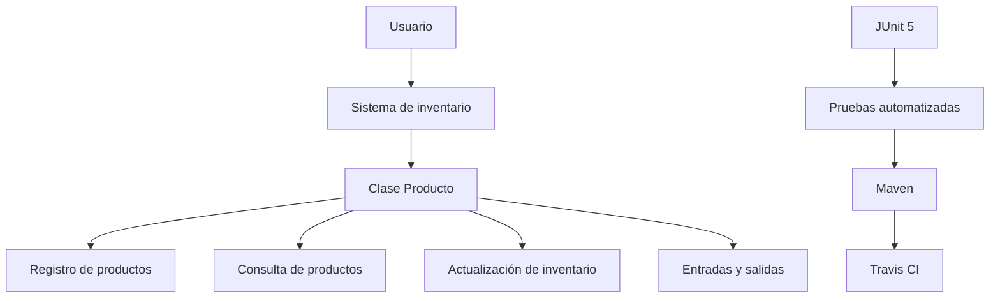

# Sistema de Inventario para una Ferretería

## Descripción
Este proyecto consiste en un prototipo de un sistema de inventario para una ferretería. Su objetivo es facilitar el registro, consulta y control de productos, así como las entradas y salidas de mercancía.

## Tecnologías utilizadas
- Java 17
- Maven
- JUnit 5
- Git y GitHub
- Zube
- Travis CI

## Arquitectura del sistema



## Funciones desarrolladas
- Registro de productos.
- Consulta de información de productos.
- Actualización de cantidades.
- Registro de entradas de mercancía.
- Registro de salidas de mercancía.
- Validación de cantidades para evitar valores negativos y salidas mayores al inventario disponible.

## Pruebas
Se realizaron 7 pruebas unitarias utilizando JUnit 5. Todas finalizaron correctamente, sin errores ni fallos.

Para ejecutar las pruebas localmente:

```bash
mvn clean test
```

## Control de versiones
Se utilizó GitHub para administrar el código mediante ramas, Issues y Pull Requests. También se utilizó Zube para organizar las actividades del proyecto.

## Estado del proyecto
El proyecto es un prototipo funcional de gestión de productos e inventario. Todavía no cuenta con conexión a una base de datos ni una interfaz gráfica.
